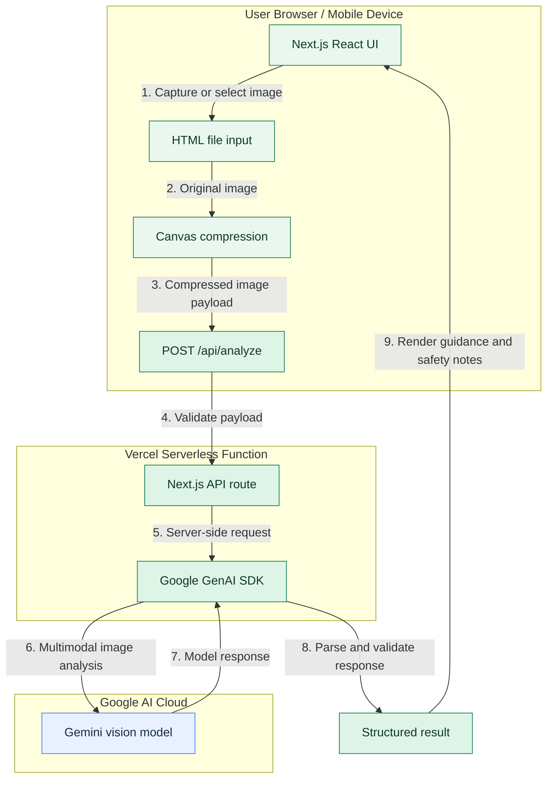

<div align="center">


# EcoSort AI

### Waste Smarter. Live Cleaner.

**An AI-first waste intelligence platform for a cleaner Bharat.**

Built for the **AI-First Product Builder Hackathon 2026**  
*Hackathon to Solve India's Garbage Problem*

<p>
  
  
  
  
  
</p>

<p>
  <a href="https://github.com/dk-khandelwal06/ecosort-ai"><strong>GitHub Repository</strong></a>
  &nbsp; • &nbsp;
  <a href="https://vercel.com/"><strong>Deploy on Vercel</strong></a>
</p>

</div>

---

## 🌱 The Problem

Waste segregation often becomes confusing at the moment of disposal. People may not know whether an item belongs with wet waste, dry recyclables, sanitary waste, or domestic hazardous waste. Incorrect sorting can contaminate recyclable material and create additional risks for waste handlers.

## ♻️ Our Solution

**EcoSort AI** is a mobile-first web assistant designed to help people identify waste from an image and understand practical next steps. The intended workflow combines image-based AI analysis with material identification, preparation tips, disposal guidance, and safety considerations.

The project focuses on two connected areas:

- **Waste collection and segregation**
- **Recycling and the circular economy**

## ✨ Key Features

<table>
  <tr>
    <td align="center" width="50%">
      <h3>📷 AI Waste Scanner</h3>
      Upload or capture an item image and request AI-assisted identification.
    </td>
    <td align="center" width="50%">
      <h3>♻️ Segregation Guidance</h3>
      Present likely waste categories and practical preparation or disposal steps.
    </td>
  </tr>
  <tr>
    <td align="center" width="50%">
      <h3>🛡️ Safety Awareness</h3>
      Highlight potentially hazardous items and encourage appropriate handling.
    </td>
    <td align="center" width="50%">
      <h3>📱 Responsive Experience</h3>
      A web interface designed for mobile, tablet, and desktop screens.
    </td>
  </tr>
  <tr>
    <td align="center" width="50%">
      <h3>📚 Waste Guide</h3>
      Help users learn about common waste categories and responsible disposal.
    </td>
    <td align="center" width="50%">
      <h3>🌗 Light & Dark Themes</h3>
      A nature-inspired interface with forest-green, emerald, and warm-ivory tones.
    </td>
  </tr>
</table>

> **Responsible-use note:** AI output is advisory and can be wrong. Always follow local municipal guidance, especially for sanitary, electronic, chemical, battery, and other hazardous waste.

---

## 🧰 Technology Stack

| Layer | Technology | Role |
|:--|:--|:--|
| Frontend framework | Next.js 14 / React | Web application and routing |
| Language | TypeScript | Typed application code |
| Styling | Tailwind CSS | Responsive UI and design system |
| Icons | Lucide React | Consistent interface iconography |
| AI integration | Google Gemini API / `@google/genai` | Multimodal image analysis |
| Authentication | Supabase (optional) | Authentication where configured |
| Version control | Git and GitHub | Source control and collaboration |
| Deployment | Vercel | Hosting and deployment workflow |

---

## 🏗️ Architecture & Data Flow

The diagram below preserves the project's core architecture: the browser prepares the image, the server-side API calls Gemini securely, and the structured result is returned to the user interface.



### 🔄 Request lifecycle

1. **Capture:** The user selects or captures a waste-item image.
2. **Prepare:** The browser can resize and compress the image before upload.
3. **Validate:** The server route checks the incoming request.
4. **Analyse:** The server calls the configured Gemini model without exposing the API key to the browser.
5. **Format:** The response is parsed into a predictable result structure.
6. **Guide:** The interface presents the likely item, category, disposal advice, and relevant safety notes.

---

## 📁 Project Folder Structure

> This is the intended project layout documented for EcoSort AI. If your checked-out repository differs, use the actual files present in GitHub as the source of truth.

```text
ecosort-ai/
├── public/
│   ├── assets/                  # Product artwork and visual assets
│   │   ├── hero-artwork.png
│   │   ├── how-it-works.png
│   │   ├── waste-categories.png
│   │   ├── material-textures.png
│   │   └── brand-concept.png
│   ├── videos/                  # Optimised demonstration/background videos
│   │   ├── hero-loop.mp4
│   │   ├── cleaner-bharat.mp4
│   │   └── waste-analysis.mp4
│   └── favicon.svg              # Browser favicon
├── src/
│   ├── app/
│   │   ├── api/
│   │   │   └── analyze/
│   │   │       └── route.ts     # Server-side AI analysis endpoint
│   │   ├── scan/
│   │   │   └── page.tsx         # Waste scanner page
│   │   ├── guide/
│   │   │   └── page.tsx         # Waste guide
│   │   ├── login/
│   │   │   └── page.tsx         # Sign-in page, if configured
│   │   ├── signup/
│   │   │   └── page.tsx         # Sign-up page, if configured
│   │   ├── privacy/
│   │   │   └── page.tsx         # Privacy information
│   │   ├── terms/
│   │   │   └── page.tsx         # Terms and AI disclaimer
│   │   ├── not-found.tsx        # Custom not-found page
│   │   ├── globals.css          # Global styles and theme tokens
│   │   ├── layout.tsx           # Root application layout
│   │   └── page.tsx             # Landing page
│   ├── components/
│   │   ├── BrandLogo.tsx        # Brand mark
│   │   ├── CategoryBadge.tsx    # Waste-category badge
│   │   ├── Footer.tsx           # Footer and legal links
│   │   ├── Header.tsx           # Main navigation
│   │   ├── ResultCard.tsx       # Analysis result presentation
│   │   ├── Scanner.tsx          # Image capture/upload flow
│   │   ├── ThemeProvider.tsx    # Theme context, if used
│   │   ├── ThemeToggle.tsx      # Light/dark mode control
│   │   └── VideoPlayer.tsx      # Video component, if used
│   └── lib/
│       ├── categories.ts        # Waste category definitions
│       ├── prompts.ts           # AI prompt and response guidance
│       ├── supabase.ts          # Supabase setup, if configured
│       └── types.ts             # Shared TypeScript types
├── .env.example                 # Placeholder environment variables
├── .gitignore                  # Ignore rules and secret protection
├── next.config.mjs              # Next.js configuration
├── package.json                 # Dependencies and scripts
├── package-lock.json            # npm dependency lockfile
├── postcss.config.js            # PostCSS configuration
├── tailwind.config.ts           # Tailwind configuration
├── tsconfig.json                # TypeScript configuration
└── README.md                    # Project documentation
```

---

## 🚀 Run Locally

### Prerequisites

- Node.js version supported by the project's Next.js version
- npm
- A Gemini API key from [Google AI Studio](https://aistudio.google.com/app/apikey)

### 1. Clone the repository

```bash
git clone https://github.com/dk-khandelwal06/ecosort-ai.git
cd ecosort-ai
```

### 2. Install dependencies

```bash
npm install
```

### 3. Configure environment variables

Copy `.env.example` to `.env.local`, then add your own values. On Windows PowerShell:

```powershell
Copy-Item .env.example .env.local
```

Example variable names:

```env
GEMINI_API_KEY=your_gemini_api_key
NEXT_PUBLIC_SUPABASE_URL=https://your-project.supabase.co
NEXT_PUBLIC_SUPABASE_ANON_KEY=your_publishable_key
```

Supabase values are optional if authentication is not enabled in your setup. **Never commit `.env.local` or expose server-side secrets in client code.**

### 4. Start the development server

```bash
npm run dev
```

Open [http://localhost:3000](http://localhost:3000).

### 5. Verify a production build

```bash
npm run build
npm run start
```

Run only scripts that are present in the repository's `package.json`.

---

## ☁️ GitHub & Vercel Deployment

1. Push the project to [GitHub](https://github.com/dk-khandelwal06/ecosort-ai).
2. Sign in to [Vercel](https://vercel.com/) and select **Add New Project**.
3. Import the `ecosort-ai` repository.
4. Confirm the project root and Next.js framework settings.
5. Add the required environment variables in the Vercel project settings.
6. Deploy and open the generated URL.
7. Test image upload, AI analysis, mobile layout, theme switching, and legal pages.

Vercel usually detects Next.js build settings automatically. Do not add unnecessary build or output overrides unless the project requires them.

### Environment variables

| Variable | Required when | Notes |
|:--|:--|:--|
| `GEMINI_API_KEY` | AI scanning is enabled | Server-side secret; never expose it to the browser |
| `NEXT_PUBLIC_SUPABASE_URL` | Supabase is configured | Project URL |
| `NEXT_PUBLIC_SUPABASE_ANON_KEY` | Supabase is configured | Use the appropriate publishable/legacy anon key for your project; never use a service-role secret here |

---

## ✅ Pre-Submission Checklist

- [ ] Landing page and navigation work.
- [ ] Scanner accepts a supported image.
- [ ] Gemini analysis works with a valid server-side key.
- [ ] Invalid or oversized images are handled gracefully.
- [ ] Results communicate uncertainty where appropriate.
- [ ] Safety-sensitive items receive cautious guidance.
- [ ] Mobile and desktop layouts are usable.
- [ ] Light and dark modes work, if included.
- [ ] Privacy and terms pages load, if included.
- [ ] No API keys or `.env.local` are committed.
- [ ] Production build completes successfully.
- [ ] Deployed Vercel URL has been tested.

Only mark checks complete after verifying them in the actual project.

---

## ⚠️ Limitations & Responsible AI

- **Guidance, not official advice:** AI results can be inaccurate and should not replace local municipal instructions.
- **Local rules vary:** Accepted materials and collection practices differ between cities and waste-management providers.
- **Hazardous items need care:** Batteries, e-waste, chemicals, sanitary waste, and broken glass may require dedicated handling or authorised collection.
- **Privacy matters:** Keep API credentials server-side and clearly explain how images and any optional account data are processed.

---

## 👥 Team Fluxara

<div align="center">

<table>
  <tr>
    <th align="center">Team Member</th>
    <th align="center">Contribution</th>
    <th align="center">Profiles</th>
  </tr>
  <tr>
    <td align="center"><strong>Daksh Khandelwal</strong><br/>Team Lead</td>
    <td align="center">Frontend architecture, UX/UI, camera and image-compression flow</td>
    <td align="center"><a href="https://github.com/dk-khandelwal06">GitHub</a><br/><a href="https://www.linkedin.com/in/daksh-khandelwal-b02748391/">LinkedIn</a></td>
  </tr>
  <tr>
    <td align="center"><strong>Khushi Kushwah</strong></td>
    <td align="center">Backend/serverless workflow, Gemini AI integration, deployment</td>
    <td align="center"><a href="https://github.com/khushikushwah213">GitHub</a><br/><a href="https://www.linkedin.com/in/khushi-kushwah-94420b421/">LinkedIn</a></td>
  </tr>
</table>

**Hackathon:** AI-First Product Builder Hackathon 2026  
**Mission:** Technology for a Cleaner Bharat

</div>

---

<div align="center">

### ♻️ Waste Smarter. Live Cleaner.

**Think. Build. Make an impact.**

<sub>Built by Team Fluxara • EcoSort AI</sub>

</div>
