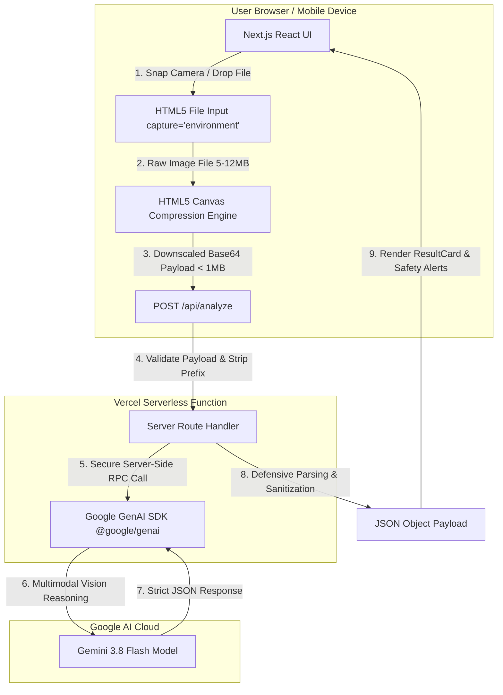

# EcoSort AI

> **Waste Smarter. Live Cleaner.**  
> *AI-First Waste Intelligence Platform &bull; Built for Hackathon 2026: Technology for a Cleaner Bharat*

[](https://nextjs.org/)
[](https://www.typescriptlang.org/)
[](https://tailwindcss.com/)
[](https://ai.google.dev/)
[](https://vercel.com/)
[](LICENSE)

---

## 1. Overview & Problem Statement

India generates approximately **170,338 tonnes of municipal solid waste per day (TPD)**. While collection networks across Urban Local Bodies (ULBs) achieve over 95% reach, scientific disposal and treatment severely lag because incoming waste arrives heavily mixed.

When biodegradable organic matter (comprising ~51.3% of municipal waste) commingles with dry recyclables and hazardous materials, the entire batch becomes contaminated and economically unviable for composting and Material Recovery Facilities (MRFs).

### The Cognitive Friction Gap
Under the **Swachh Bharat Mission-Urban 2.0 (SBM-U 2.0)** and **Solid Waste Management Rules 2026**, the Government of India mandates strict 4-way source segregation:
1. **Wet Waste** (Green Bin)
2. **Dry Waste** (Blue Bin)
3. **Sanitary Waste** (Yellow Bin / Red-Dot Pouch)
4. **Domestic Hazardous Waste** (Red Bin / Authorized E-Waste Centers)

Modern consumer packaging—such as Multi-Layered Plastics (MLPs), metallized crisp wrappers, composite cartons, and blister packs—creates severe cognitive friction at the household bin. When citizens are unsure, they default to tossing items into general garbage.

**EcoSort AI** is an ultra-accessible, mobile-first web assistant that intervenes at the moment of disposal. By snapping a photograph, users immediately receive zero-shot multimodal AI identification, actionable preparation steps (rinse, flatten, separate), and exact SBM-U 2.0 bin allocation.

---

## 2. Core Features

- **Zero-Friction, No-Login Core Flow:** Users can immediately photograph or upload waste items without app-store downloads or mandatory registrations.
- **Client-Side Canvas Compression:** High-resolution mobile phone camera captures (5–12MB) are automatically resized in-browser to a maximum dimension of 800px and converted to JPEG (0.7 quality), guaranteeing payload transmission stays under 1MB to circumvent Vercel's 4.5MB serverless payload limit.
- **Real Multimodal AI Integration:** Powered server-side by Google Gemini Vision via the official `@google/genai` Node.js SDK. Zero hardcoded responses.
- **Strict 4-Stream Indian Municipal Schema:** Categorizes objects strictly into official SBM-U 2.0 streams with material composition, preparation steps, and disposal directions.
- **Safety Hazard Override:** Flags batteries, e-waste, chemicals, and broken glass shards in prominent error-red alert containers to prevent compactor truck fires and sanitation worker injuries.
- **Comprehensive SBM-U 2.0 Waste Guide:** Detailed searchable handbook covering organics, dry packaging, sanitary disposal, and Battery Waste Management Rules 2026.
- **Engineered Light and Dark Modes:** Tailored color tokens (Forest Green, Emerald, Warm Ivory, Lime) with anti-FOUC (Flash of Unstyled Content) scripts and system preference synchronization.
- **Supabase Auth Ready:** Structured sign-in and sign-up flows with clear provider status handling.
- **Zero-Retention Ephemeral Privacy:** Images are processed in-memory and discarded post-analysis; scan history is stored exclusively in client-side `localStorage`.

---

## 3. Technology Stack

| Layer | Technology | Purpose |
| :--- | :--- | :--- |
| **Framework** | Next.js 14 (App Router) | Unified SSR, Edge routing, and API serverless functions |
| **Language** | TypeScript | Strict type safety for AI JSON schemas and UI states |
| **Styling** | Tailwind CSS (v3.4) | Design-token styling with custom dark-mode surfaces |
| **Icons** | Lucide React | Lightweight, consistent SVG iconography (No emojis) |
| **AI Integration** | `@google/genai` (v2.28) | Official Google GenAI Node.js SDK |
| **AI Model** | Google Gemini 3.8 Flash | Multimodal zero-shot vision classification |
| **Authentication** | `@supabase/supabase-js` | Secure identity management (optional / unconfigured fallback) |
| **Deployment** | Vercel | Serverless hosting with automated GitHub CI/CD |

---

## 4. Architecture & Data Flow



---

## 5. Project Folder Structure

```
ecosort-ai/
├── public/
│   ├── assets/               # Production image assets & textures
│   │   ├── hero-artwork.png
│   │   ├── how-it-works.png
│   │   ├── waste-categories.png
│   │   ├── material-textures.png
│   │   └── brand-concept.png
│   ├── videos/               # Optimized demonstration video loops
│   │   ├── hero-loop.mp4
│   │   ├── cleaner-bharat.mp4
│   │   └── waste-analysis.mp4
│   └── favicon.svg           # Geometric circular leaf brand favicon
├── src/
│   ├── app/
│   │   ├── api/
│   │   │   └── analyze/
│   │   │       └── route.ts  # Serverless API: Google GenAI vision endpoint
│   │   ├── scan/
│   │   │   └── page.tsx      # Dedicated AI Waste Scanner route
│   │   ├── guide/
│   │   │   └── page.tsx      # SBM-U 2.0 Waste Knowledge Guide
│   │   ├── login/
│   │   │   └── page.tsx      # Sign-in page (Supabase Auth)
│   │   ├── signup/
│   │   │   └── page.tsx      # Registration page (Supabase Auth)
│   │   ├── privacy/
│   │   │   └── page.tsx      # Comprehensive ephemeral privacy policy
│   │   ├── terms/
│   │   │   └── page.tsx      # Operational terms & AI advisory disclaimer
│   │   ├── not-found.tsx     # Custom 404 navigation screen
│   │   ├── globals.css       # Theme CSS tokens, custom scrollbars
│   │   ├── layout.tsx        # Root layout, anti-FOUC script, Inter font
│   │   └── page.tsx          # High-impact landing page
│   ├── components/
│   │   ├── BrandLogo.tsx     # Vector SVG brand emblem & typography
│   │   ├── CategoryBadge.tsx # SBM-U 2.0 color-coded stream badge
│   │   ├── Footer.tsx        # Platform footer with legal & credits
│   │   ├── Header.tsx        # Navigation header with theme switcher
│   │   ├── ResultCard.tsx    # Parsed AI instructions & hazard alerts
│   │   ├── Scanner.tsx       # Core camera capture & compression logic
│   │   ├── ThemeProvider.tsx # Client-side theme React context
│   │   ├── ThemeToggle.tsx   # Light/Dark toggle button
│   │   └── VideoPlayer.tsx   # Accessible video with poster fallback
│   └── lib/
│       ├── categories.ts     # Official SBM-U 2.0 category definitions
│       ├── prompts.ts        # Gemini system prompt & schema contract
│       ├── supabase.ts       # Supabase client wrapper & configuration check
│       └── types.ts          # TypeScript interfaces
├── .env.example              # Placeholder environment configuration template
├── .gitignore                # Node, Next.js, and secret protection rules
├── next.config.mjs           # Next.js configuration
├── package.json              # Dependency manifests & npm scripts
├── postcss.config.js         # PostCSS configuration
├── tailwind.config.ts        # EcoSort color palette & design tokens
└── tsconfig.json             # TypeScript compiler settings
```

---

## 6. Local Installation & Setup

### Prerequisites
- Node.js `v18.18+` or `v20+` (tested on Node v24)
- npm `v9+` or `v11+`
- A Google Gemini API Key from [Google AI Studio](https://aistudio.google.com/app/apikey)

### Step 1: Clone Repository
```bash
git clone https://github.com/dk-khandelwal06/ecosort-ai.git
cd ecosort-ai
```

### Step 2: Install Dependencies
```bash
npm install
```

### Step 3: Configure Environment Variables
Copy `.env.example` to create a local `.env.local` file:
```bash
cp .env.example .env.local
```
Edit `.env.local` and add your Gemini API key:
```ini
GEMINI_API_KEY=your_actual_gemini_api_key_here

# Optional: Supabase configuration if authentication is enabled
NEXT_PUBLIC_SUPABASE_URL=https://your-project.supabase.co
NEXT_PUBLIC_SUPABASE_ANON_KEY=your_supabase_anon_key_here
```

### Step 4: Run Development Server
```bash
npm run dev
```
Open [http://localhost:3000](http://localhost:3000) in your browser.

### Step 5: Test Production Build Locally
```bash
npm run build
npm run start
```

---

## 7. Step-by-Step GitHub & Vercel Deployment Guide

### Target GitHub Repository
**Owner:** [dk-khandelwal06](https://github.com/dk-khandelwal06)  
**Repository:** `https://github.com/dk-khandelwal06/ecosort-ai.git`

### Step 1: Initialize Git & Commit (PowerShell)
```powershell
# Verify git status
git status

# If git is not initialized, run:
git init
git branch -M main

# Verify .env.local is NOT staged (protected by .gitignore)
git add .
git status

# Commit changes
git commit -m "feat: complete EcoSort AI platform build for Hackathon 2026"
```

### Step 2: Push to GitHub
```powershell
# Add remote origin
git remote add origin https://github.com/dk-khandelwal06/ecosort-ai.git

# Push to main branch
git push -u origin main
```

### Step 3: Deploy to Vercel
1. Log in to [Vercel](https://vercel.com).
2. Click **"Add New..." &rarr; "Project"**.
3. Under *Import Git Repository*, select `dk-khandelwal06/ecosort-ai`.
4. Verify project settings:
   - **Framework Preset:** Next.js
   - **Root Directory:** `./`
   - **Build Command:** `npm run build`
   - **Output Directory:** `.next`
5. Expand **Environment Variables** and add:
   - `GEMINI_API_KEY` = `your_actual_gemini_api_key` (Server-only secret)
   - *(Optional)* `NEXT_PUBLIC_SUPABASE_URL` = `https://your-project.supabase.co`
   - *(Optional)* `NEXT_PUBLIC_SUPABASE_ANON_KEY` = `your_anon_key`
6. Click **Deploy**. Vercel will build and assign your production deployment URL.

---

## 8. Deployment Verification Checklist

- [x] Landing page (`/`) loads with hero video/poster and brand identity.
- [x] AI Scanner (`/scan`) opens camera on mobile and file picker on desktop.
- [x] Client-side canvas compression downscales images to `< 1MB`.
- [x] Server-side `/api/analyze` securely communicates with Gemini Vision.
- [x] Strict 4-way SBM-U 2.0 category mapping (Wet, Dry, Sanitary, Domestic Hazardous).
- [x] Batteries and hazardous items trigger prominent Red Safety Warnings.
- [x] Waste Knowledge Guide (`/guide`) interactive search works.
- [x] Light and Dark modes switch instantly without FOUC.
- [x] Privacy Policy (`/privacy`) and Terms (`/terms`) load directly.
- [x] API key is stored strictly on the server; zero secrets exposed in client bundles.
- [x] `npm run build` compiles with 0 errors and 0 warnings.

---

## 9. Limitations & Responsible AI Notice

- **Advisory Civic Guidance:** EcoSort AI provides visual multimodal estimates to assist household segregation. It does not replace official municipal orders.
- **Municipal Variability:** Material acceptance standards and bin color conventions may vary by Urban Local Body (ULB).
- **Hazardous Materials:** Intact batteries, fluorescent lamps, and chemical packaging must always be surrendered to certified recyclers or dedicated municipal collection kiosks.

---

## 10. Contributors & Credits

Built for the **AI-First Product Builder Hackathon 2026: Technology for a Cleaner Bharat**.

- **Daksh Khandelwal** &bull; Frontend Architecture, UX/UI, Camera & Compression Logic
- **Khushi Kushwah** &bull; Backend Serverless Infrastructure, Gemini AI Multimodal Integration, Deployment
